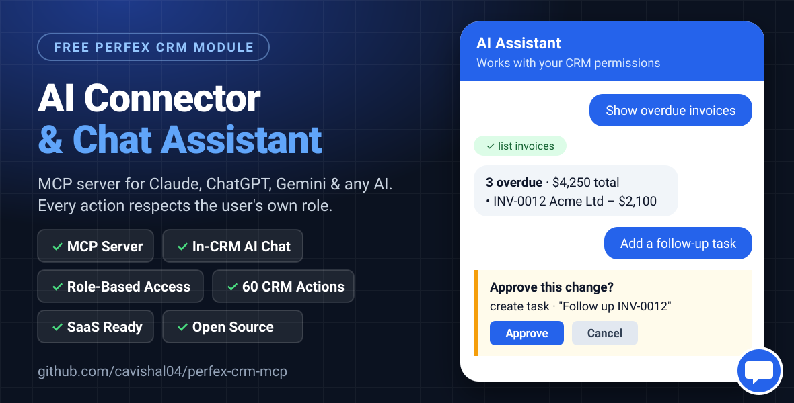

<div align="center">

# Perfex CRM MCP Server & AI Chat Assistant

**Connect Perfex CRM to Claude, ChatGPT, Gemini, Cursor and any AI through the Model Context Protocol (MCP), and add an AI chatbot inside your CRM.**

Free and open-source Perfex CRM module · Role-based AI access · Perfex SaaS ready

[](LICENSE)
[](#requirements)
[](#requirements)
[](https://modelcontextprotocol.io)
[](#project-status)



</div>

> 💡 **Want an MCP server for another software?** Tally, Zoho, Odoo, WHMCS, a custom ERP or anything
> else: [**open a request here**](https://github.com/cavishal04/perfex-crm-mcp/issues/new?title=MCP%20request:%20&labels=mcp-request)
> and I'll try to build it.

---

**Perfex CRM AI Connector** is a free Perfex CRM module. It turns your CRM into an **MCP server**,
so AI assistants such as **Claude, ChatGPT, Gemini, Cursor and VS Code** can read and update your CRM
data. It also adds a built-in **AI chatbot** to every page of the CRM.

Ask in plain language:

> *"What tasks are overdue for me this week?"*
> *"Create a lead for Ravi Kumar from Acme Ltd, source Google, and remind me to call him on Friday."*
> *"Show unpaid invoices for Sharma Traders."* · *"Convert estimate EST-0042 into an invoice."*

The AI finds the right records and does the work, **with exactly the permissions of the staff member
using it, never more.**

## Contents

- [Features](#features)
- [How it works](#how-it-works)
- [Requirements](#requirements)
- [Installation](#installation)
- [Connect Claude, ChatGPT, Cursor or any MCP client](#connect-claude-chatgpt-cursor-or-any-mcp-client)
- [AI chat assistant inside Perfex CRM](#ai-chat-assistant-inside-perfex-crm)
- [Security and role-based permissions](#security-and-role-based-permissions)
- [All 60 CRM actions](#all-60-crm-actions)
- [Perfex SaaS: enable per package](#perfex-saas-enable-per-package)
- [Add AI actions for other modules](#add-ai-actions-for-other-modules)
- [Troubleshooting](#troubleshooting)
- [FAQ](#faq)
- [Project status](#project-status)
- [Contributing and requests](#contributing-and-requests)

## Features

- 🔌 **MCP server for Perfex CRM**: works with Claude (web, desktop and Code), ChatGPT connectors, Cursor, VS Code and any client that supports MCP's Streamable HTTP transport
- 💬 **Built-in AI chatbot**: a floating assistant on every CRM page, powered by Claude, OpenAI, Google Gemini, OpenRouter, Groq, DeepSeek or a self-hosted Ollama
- 🛡️ **Role-based access**: an admin's AI can do what an admin can, and an accountant's AI only what an accountant can
- ✍️ **Read and write**: customers, leads, tasks, projects, invoices, estimates, payments, expenses, contracts, tickets and more ([60 actions](#all-60-crm-actions))
- ✅ **Approval before changes**: the chat shows an *Approve / Cancel* card before creating or editing anything
- 📜 **Audit log**: every AI action is recorded with who did it, what was done and the result
- 🔑 **Personal access tokens** per staff member: stored hashed, revocable, with last-used time and IP
- 🏢 **Perfex SaaS ready**: offer it only on chosen packages, and each tenant uses its own AI key
- 🧩 **Extensible**: other modules (bookkeeping, email and so on) can add their own AI actions with one hook
- 🌍 **No vendor lock-in**: users can bring their own AI subscription, and the in-CRM chat can use a free Gemini key

## How it works

```
 Claude / ChatGPT / Cursor ──MCP (HTTPS + personal token)──┐
                                                           ▼
 Built-in chat bubble ──► your AI provider ──► Perfex CRM AI Connector ──► Perfex models & permissions
                                                     (runs as the staff member, logged)
```

Every request runs **as the staff member who owns the token, or who is logged in for the chat**.
Perfex's own permission and visibility rules decide what the AI can see and change.

## Requirements

- Perfex CRM **3.0 or newer** (single install or Perfex SaaS)
- PHP **7.4+** (8.1+ recommended) with cURL
- **HTTPS** on your CRM domain (Claude.ai and ChatGPT connect from their own servers)
- For the in-CRM chat: an API key from any supported AI provider (Google Gemini has a free tier)

## Installation

1. Download **`ai_mcp.zip`** from the [latest release](https://github.com/cavishal04/perfex-crm-mcp/releases),
   or download this repository and zip the `ai_mcp` folder.
2. In Perfex go to **Setup → Modules → Upload module**, upload the zip and click **Activate**.
3. Go to **Setup → AI Connector (MCP)** and tick **Enable**. Choose who can use it, and optionally add an AI
   key for the chat assistant.
4. Allow the MCP endpoint through Perfex's CSRF protection. In `application/config/config.php`, add
   `'ai_mcp/mcp.*'` to `$config['csrf_exclude_uris']`:
   ```php
   $config['csrf_exclude_uris'] = ['ai_mcp/mcp.*', /* ...existing entries... */];
   ```
   The endpoint is protected by personal tokens instead of CSRF.

## Connect Claude, ChatGPT, Cursor or any MCP client

Each staff member opens **AI Assistant** in the sidebar and clicks **Create token**. The page then shows
copy-paste setup with the token already filled in:

| AI app | How to connect |
|---|---|
| **Claude.ai** | Settings → Connectors → *Add custom connector* → paste `https://your-crm.com/ai_mcp/mcp/t/<token>` |
| **ChatGPT** | Settings → Connectors (developer mode) → Create → *No authentication* → paste the same URL |
| **Claude Desktop** | `claude_desktop_config.json` using `mcp-remote` (config generated for you) |
| **Claude Code** | `claude mcp add --transport http perfex-crm https://your-crm.com/ai_mcp/mcp --header "Authorization: Bearer <token>"` |
| **Cursor / VS Code / others** | `{"url": "https://your-crm.com/ai_mcp/mcp", "headers": {"Authorization": "Bearer <token>"}}` |

Opening the endpoint URL in a browser shows a **diagnostic page** (routing, module enabled, token valid),
which makes setup problems easy to spot.

## AI chat assistant inside Perfex CRM

- A floating chat button on every admin page, with a separate conversation history for each user
- Providers: **Anthropic Claude**, **OpenAI**, **Google Gemini**, **OpenRouter**, **Groq**, **DeepSeek**,
  **Ollama** or any OpenAI-compatible API, with one-click presets
- The API key is stored encrypted, and a **Test connection** button checks it
- Custom instructions, for example *"Our financial year starts 1 April; amounts are in INR."*
- Answers in Markdown with direct links to CRM records

> On free AI tiers such as Gemini's, the provider may use prompts to improve its models. For real
> client data, use a paid API tier.

## Security and role-based permissions

- **The AI only sees the actions the user is allowed to use.** A user without invoice permission never sees invoice actions.
- **Same visibility rules as Perfex**: *view all* vs *view own*, customer admins, project members, task
  assignees and followers, invoice sale agents and ticket departments.
- **Every write is checked on the specific record**, against the user's create or edit permission.
- **Instant revoke**: deactivate the user, change their role, revoke the token or turn the module off, and access stops on the next request.
- **Deletes are off by default.** When allowed, they only work for users who already have delete permission.
- **No admin powers**: the AI cannot change CRM settings, staff, roles, permissions or its own connector settings.
- Tokens are stored as SHA-256 hashes, the AI key is encrypted, and every action goes into the **AI activity log**.

## All 60 CRM actions

| Area | Read | Write |
|---|---|---|
| General | `whoami`, `search_crm`, `get_reference_data`, `dashboard_summary` | `add_reminder` |
| Customers | `list_customers`, `get_customer` | `create_customer`, `update_customer`, `add_contact`, `add_note` |
| Leads | `list_leads`, `get_lead` | `create_lead`, `update_lead`, `mark_lead`, `convert_lead_to_customer`, `delete_lead`* |
| Tasks | `list_tasks`, `get_task` | `create_task`, `update_task`, `update_task_status`, `assign_task`, `add_task_follower`, `add_task_comment`, `add_checklist_item`, `log_time`, `delete_task`* |
| Projects | `list_projects`, `get_project` | `create_project`, `update_project`, `add_project_member`, `add_milestone` |
| Invoices & payments | `list_invoices`, `get_invoice`, `list_payments`, `list_credit_notes` | `create_invoice` (draft), `record_payment` |
| Estimates & proposals | `list_estimates`, `get_estimate`, `list_proposals`, `get_proposal` | `create_estimate` (draft), `convert_estimate_to_invoice` |
| Contracts | `list_contracts`, `get_contract` | `create_contract` |
| Products / services | `list_items` | `create_item` |
| Expenses | `list_expenses` | `create_expense` |
| Support | `list_tickets`, `get_ticket`, `search_knowledge_base` | `create_ticket`, `reply_ticket`, `update_ticket` |

\* only when *Allow delete* is enabled **and** the user has delete permission.

## Perfex SaaS: enable per package

With Perfex SaaS, the super admin ticks **AI Connector (MCP)** in **Packages → Modules** for the plans that
should include it. Tenants on other plans never load the module. Each tenant's owner then:

- switches it on,
- chooses who can use it (all staff, or only roles with the *AI Connector → Use* permission),
- adds their own AI key, so each tenant pays for its own AI usage.

For custom plan checks, use the `ai_mcp_tenant_allowed` filter.

## Add AI actions for other modules

Have a bookkeeping, email or Outlook module? Give the AI access to it with the `ai_mcp_tools` hook. Its
actions automatically get permission checks, are hidden while the module is inactive, and are logged.
See **[EXTENDING.md](EXTENDING.md)**.

## Troubleshooting

| Problem | Fix |
|---|---|
| *"Couldn't connect to the server"* in Claude or ChatGPT | Open the endpoint URL in a browser to see the diagnostic, then complete the CSRF step in [Installation](#installation) |
| `403 The action you have requested is not allowed` | Add `'ai_mcp/mcp.*'` to `csrf_exclude_uris` |
| 403 from Cloudflare or ModSecurity | Allow `/ai_mcp/mcp` in your firewall or WAF |
| The AI says it has no access | Check the user's role permissions in Perfex. The AI mirrors them exactly |
| Chat says the provider is not configured | Add an API key in Setup → AI Connector, save, then click *Test connection* |

## FAQ

### Does Perfex CRM work with ChatGPT or Claude?
Yes. With this module installed, ChatGPT (through connectors) and Claude (web, desktop and Code) can
connect to Perfex CRM through MCP and work with your customers, leads, tasks, invoices and tickets.

### Is this Perfex CRM AI module free?
Yes. It's free and open source under the MIT license. The in-CRM chat needs your own AI provider key,
which can be free (for example Google Gemini's free tier). External AI apps use each person's own subscription.

### Can the AI see data a user isn't allowed to see?
No. Every request runs as that staff member and uses Perfex's own permission and visibility rules.

### Does it work with Perfex SaaS (multi-tenant)?
Yes. Offer it per package. Each tenant's data, settings and AI key stay separate.

### Can I use Claude Desktop's free plan for the chat bubble?
No. The in-CRM chat needs an API key, because it runs on your server. Claude Desktop connects as an MCP
client instead, using the person's own Claude plan.

### What is MCP?
The [Model Context Protocol](https://modelcontextprotocol.io) is an open standard that lets AI assistants
use tools and data from other software securely.

## Project status

**Beta.** Tested on a live Perfex CRM SaaS tenant:
- the MCP connection with Claude,
- all list and read actions,
- creating customers, contacts, notes, leads, tasks and draft invoices,
- comments and status changes.

The remaining actions are implemented but not yet verified on every Perfex version, so please try them
on a staging copy first and [report issues](https://github.com/cavishal04/perfex-crm-mcp/issues).
The in-CRM chat has not yet been tested against a live AI provider.

## Contributing and requests

- 🐞 Bugs and ideas: [open an issue](https://github.com/cavishal04/perfex-crm-mcp/issues)
- 🔧 Pull requests are welcome, especially AI actions for popular Perfex modules
- 💡 **Need an MCP server or AI integration for another software?** [Request it here](https://github.com/cavishal04/perfex-crm-mcp/issues/new?title=MCP%20request:%20&labels=mcp-request)
- ⭐ If this module helps you, please star the repository so other Perfex users can find it

## License

[MIT](LICENSE) © Vishal Sharma

*Perfex CRM is a product of its respective owner. Claude, ChatGPT, Gemini and Cursor are trademarks of their
respective owners. This project is independent and not affiliated with or endorsed by them.*
